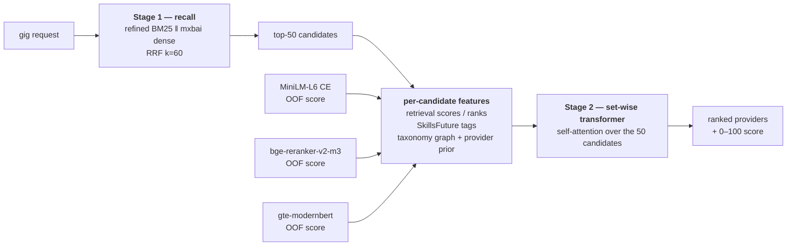

# Senseigigs — gig ↔ provider matching: retrieval + Stage-2 ranking

Given a gig (a hirer's request), return the providers best suited to do it. Stage 1 retrieves
candidates with two text retrievers fused by RRF. Stage 2 re-orders the top 50 with a **set-wise
transformer** — it attends across all 50 candidates at once and combines retrieval scores,
SkillsFuture tag-match features, taxonomy-graph features, and the **out-of-fold scores of three
fine-tuned cross-encoders**. Current best: **0.9507 NDCG@10** (see Results).

The corpus is **`pipeline/data/data_set_v5`** — 1,106 gigs × 3,024 provider showcases, with
**24,070 LLM-graded pairs** (0–3, `qwen3.8:27b`, prompt `rubric_01.v5`). The ranker reads the
same corpus with the SkillsFuture tags attached, **`pipeline/data/data_set_v5_tax`** (identical
text; `tags` added by `enrich_v5_with_tags.py`).



Each candidate is a **37-dimensional feature vector** (17 retrieval + tag, 11 Tier-1, 3 CE
scores, 6 CE rank/vote); see [Stage 3](#stage-3--set-wise-ranker-with-cross-encoder-inputs-current-best-09507).

## Results

Out-of-fold (GroupKFold by gig, no gig is scored by a model that saw it), all 1,106 gigs.
Relevance for P/R/MRR is grade ≥ 2. Noise floor at this size ≈ **0.007**.

All rows are scored against the full 24,070-pair label set. "Trained on" says which labels
the model learned from; the clean comparison is between the two rows trained on the original
labels (see "Why the tags help" below).

| System | Trained on | Artifact (`results_data/data_set_v5_tax/`) | NDCG@10 | NDCG@5 | P@5 | P@10 | R@10 | MRR |
|---|---|---|---|---|---|---|---|---|
| Stage 1 — RRF k=60 | — | — | 0.8757 | 0.8817 | 0.8745 | 0.8039 | 0.6197 | 0.9698 |
| Stage 2 — LambdaMART, 9 features (previous) | original 21,696 | `v5tax_lin_orig.json` | 0.8766 | 0.8840 | 0.8750 | 0.8037 | 0.6218 | 0.9714 |
| Stage 2 — LambdaMART + tag features | original 21,696 | `v5tax_tags_orig.json` | 0.8954 | 0.9002 | 0.8967 | 0.8288 | 0.6432 | 0.9770 |
| Stage 2 — LambdaMART + tag features (previous shipped) | all 24,070 | `v5tax_tags.json` | 0.8982 | 0.9018 | 0.8991 | 0.8304 | 0.6449 | 0.9774 |
| **Stage 3 — set-wise transformer + 3 CE inputs (current best)** | all 24,070 | `listwise_ceil_s7.json` | **0.9507** | **0.9544** | **0.9544** | **0.8898** | **0.6982** | **0.9937** |

Tags vs previous, both trained on the original labels, paired bootstrap (10k resamples):

| Metric | Δ | 95% CI | Verdict |
|---|---|---|---|
| NDCG@10 | **+0.0188** | [+0.0145, +0.0231] | better — positive on all 3 fold splits (+0.019 / +0.017 / +0.012) |
| P@5 | **+0.0217** | [+0.0150, +0.0286] | better |
| R@10 | **+0.0215** | [+0.0153, +0.0278] | better |
| MRR | +0.0055 | [−0.0001, +0.0115] | crosses 0 |

Full write-up, including the earlier rejected variants: [`ablation.md`](ablation.md).

### Tier-1 features + rank fusion (superseded by Stage 3)

On top of the shipped 17 features, `tier1_rank.py` adds three feature families and a
rank-fusion stage, under the identical OOF protocol (GroupKFold by query, linear gain,
per-query z-scored score features):

- **Taxonomy-graph partial credit** — a gig skill the provider does not hold exactly can
  still be *reached* through the `sf_v1` tree: a *sibling* skill under the same
  specialisation, or any provider skill under the same category. Adds `skill_sib_cov`,
  `skill_cat_cov`, `graph_dist_mean/min`, `spec_cat_cov`, `skill_jaccard`.
- **Interaction crosses** — `tl_x_rank`, `speccov_x_tl`, `skillcov_x_tl`.
- **Provider-prior quality** — leave-one-query-out, α-smoothed mean grade of a provider,
  **rebuilt per fold from that fold's training queries only** (no leakage).
- **Rank fusion** — weighted RRF over the rankers' OOF lists (`fuse_rankers.py`'s recipe).

| System (all OOF, all 1,106 queries, graded labels) | NDCG@10 | NDCG@5 | P@5 | P@10 | R@5 | R@10 | MRR |
|---|---|---|---|---|---|---|---|
| Stage 2 — LambdaMART + tag features (previous shipped) | 0.8982 | 0.9018 | 0.8991 | 0.8304 | 0.3638 | 0.6449 | 0.9774 |
| + 11 Tier-1 features (28 feat, alone) | 0.8913 | 0.9127 | 0.9085 | 0.8162 | 0.3692 | 0.6360 | 0.9844 |
| RRF-fuse base + Tier-1 (0.6 / 0.4) | 0.9039 | 0.9095 | 0.9069 | 0.8357 | 0.3678 | 0.6511 | 0.9811 |
| **RRF-fuse base + Tier-1 + cross-encoder (0.4 / 0.4 / 0.2)** | **0.9121** | **0.9243** | **0.9226** | **0.8429** | **0.3762** | **0.6587** | **0.9878** |

Paired bootstrap vs the previous shipped ranker (10k resamples over queries):

| Metric | Δ (fusion − shipped) | 95% CI | Verdict |
|---|---|---|---|
| NDCG@10 | **+0.0139** | [+0.0109, +0.0170] | better |
| NDCG@5 | +0.0225 | [+0.0187, +0.0263] | better |
| P@5 | **+0.0235** | [+0.0179, +0.0293] | better |
| P@10 | +0.0125 | [+0.0080, +0.0169] | better |
| R@5 | +0.0123 | [+0.0087, +0.0161] | better |
| R@10 | **+0.0138** | [+0.0096, +0.0180] | better |
| MRR | +0.0104 | [+0.0057, +0.0153] | better |

Every metric improves with a CI excluding 0, and the NDCG@10 gain is ~2× the 0.007 noise
floor. Caveat: the fusion weights were chosen on the same OOF split (a mild selection);
the direction is robust — every weight in 0.30–0.50 beats the baseline.

**The cross-encoder: still rejected as a ranker, now kept as an ensemble input.**
Fine-tuned under per-query OOF CV (`rerank_crossencoder.py`), `ms-marco-MiniLM-L6-v2`
reaches NDCG@10 **0.7706** (zero-shot 0.6165) — far below the ranker, and folding
`ce_score` in as a LambdaMART *feature* costs **−0.082 NDCG@10** (0.8781 → 0.7966) while
buying +0.011 MRR. But its errors decorrelate from the GBDT's, so as **one input to the
RRF fusion** it adds **+0.008 NDCG@10** and **+0.007 MRR** over the fusion without it.
Use it in the ensemble, not as the ranker.

### Stage 3 — set-wise ranker with cross-encoder inputs (current best, 0.9507)

A per-row GBDT scores every candidate in isolation, but NDCG@10 is a *list* metric. The current
best (`listwise_ranker_v2.py`) replaces Stage 2 with a small transformer over each gig's 50
candidates. Everything is out-of-fold by query.

**Model.** Per candidate: `Linear(37→64) → GELU → dropout 0.1 → 2 × TransformerEncoderLayer
(d=64, 4 heads, norm-first) → Linear(64→1)`. Self-attention sees the whole shortlist, so it can
learn *relative* ordering ("this provider is the best fit **for this gig**") that a per-row tree
cannot. Features are standardised **within each query**.

| Feature family | n | What |
|---|---|---|
| Retrieval + tags | 17 | bm25 / dense / rrf scores + ranks, `budget_fit`, `seniority_fit`, `avail_immediacy`, 8 SkillsFuture tag features |
| Tier-1 | 11 | taxonomy-graph partial credit, interaction crosses, fold-aware provider prior |
| Cross-encoders | 3 | OOF score from MiniLM-L6, bge-reranker-v2-m3, gte-reranker-modernbert |
| CE consensus | 6 | per-query rank of each CE score, top-10 / top-20 votes, mean rank |

**Loss.** Pairwise logistic weighted by `|gain_i − gain_j|`, using the grader's **continuous
score** (0–100) rather than the 4 coarse bins. Only graded candidates are used.

**Training.** GroupKFold by query, 7 seeds averaged per fold, 80 epochs, AdamW lr 1e-3, cosine
schedule, grad-clip 1.0, batch = 32 queries.

| Step (all OOF, all 1,106 queries) | NDCG@10 |
|---|---|
| RRF k=60 | 0.8757 |
| LambdaMART + tags (old shipped) | 0.8982 |
| Set-wise transformer, no CE | 0.9019 |
| + MiniLM CE score | 0.9303 |
| + bge-reranker-v2-m3 score | 0.9417 |
| + gte-reranker-modernbert score | 0.9454 |
| + CE rank / vote features | 0.9500 |
| + 7 seeds / 80 epochs | **0.9507** |

Paired bootstrap vs the old shipped ranker (10k resamples): NDCG@10 **+0.0525** [+0.0476,
+0.0573], NDCG@5 +0.0527, P@5 +0.0553, P@10 +0.0594, R@5 +0.0316, R@10 +0.0533, MRR +0.0163 —
**every metric, CI excludes 0**.

**Why the cross-encoders are inputs, not the ranker.** Each fine-tuned CE alone reaches only
NDCG@10 0.77–0.79, and adding `ce_score` to the LambdaMART *feature set* **hurt** (0.8781 →
0.7966). The set-wise model instead learns *per gig* how much to trust each CE, and the three
models' errors are decorrelated — each addition is a large, significant jump.

**Rejected along the way.** ListNet loss (0.8381), LambdaRank-discount loss (0.9447), a fourth
cross-encoder (0.9506), and the new budget/availability/seniority fields (0.9508, flat — see
Caveats).

### Why the tags help, and why an earlier test said they didn't

- **The tags carry signal the text retrievers miss.** Bucket the candidates by tag match
  (none → shared category → shared specialisation → shared specialisation *and* skill): at
  RRF ranks 31–50 the share graded ≥ 2 climbs 27% → 37% → 52% → 74%. Controlling for RRF rank,
  the match level still correlates with the grade (Spearman +0.25).
- **The original labels could not see it.** The judging pool was built from the text
  retrievers' top results, so a provider those retrievers ranked low was usually never graded —
  and `evaluate.py` scores an ungraded pair as grade 0. The tag ranker promotes exactly those
  providers: before re-grading, 13% of its top-10 was ungraded, which read as a −0.04 NDCG@10
  regression (`ablation.md` §2, the "+ taxonomy features" row).
- **So we graded them.** The 2,383 ungraded pairs that any tag variant placed in its top-10 were
  graded with the same model and prompt (a 60-pair re-grade of already-graded pairs reproduced
  **60/60** grades exactly; 9 pairs failed on malformed replies). 67% came back grade ≥ 2.
  They are in `pipeline/data/data_set_v5/judgments_topup_tags.jsonl` and merged by
  `merge_topup_grades.py`. With them, both systems' top-10s are ~99% graded and the tags win.
- **Exact matching is the right default for the hierarchy.** Category (37 values) and
  specialisation (144) are a closed vocabulary. Skills (825) are not: exact string match misses
  near-synonyms, so `skill_soft` (embedding similarity of the skill names) adds a middle tier.
  Industry is left out: a provider's industry is always one of its tag categories.

## Layout

| Path | What |
|---|---|
| `pipeline/data/data_set_v5/` | Corpus + labels: `hirers.json`, `providers.json`, `llm_judgments_merged.json` (0–3), `ground_truth_llm.json` (0/33/67/100), judging pools, `judgments_topup_tags.jsonl` (the 2,374 grades added for the tag test) |
| `pipeline/data/data_set_v5_tax/` | The same corpus with the SkillsFuture `tags` grafted on — what the shipped ranker reads |
| `pipeline/run_pipeline.py`, `retrieval_*.py` | Stage 1: refined BM25, mxbai dense, RRF |
| `pipeline/features.py` | Builds `features_data/<corpus>/candidates_top50.csv` (top-50 pool + retrieval features + labels) |
| `pipeline/tag_features.py` | Builds `tag_features.csv`, the 8 tag-match features. Run in its own process (torch) |
| `pipeline/rerank_ltr.py` | LambdaMART (XGBoost `rank:ndcg`). Shipped flags: `--linear-gain --normalize-scores zscore --tag-features` |
| `pipeline/tier1_rank.py` | Tier-1 features (taxonomy-graph partial credit, interaction crosses, fold-aware provider prior) + weighted-RRF rank fusion — the 0.9121 NDCG@10 configuration |
| `pipeline/listwise_ranker.py`, `listwise_ranker_v2.py` | **Current best**: set-wise transformer over the 50 candidates; v2 consumes the 3 CE OOF scores + rank/vote features (`listwise_ceil_s7.json`, 0.9507) |
| `pipeline/hpo_ltr.py`, `soft_label_rank.py`, `rank_feature_ranker.py` | LambdaMART HPO; continuous-score regression; per-query rank features |
| `pipeline/bm25_fields.py` | Per-section BM25 columns (restores the `--bm25-fields` flag; measured negative) |
| `pipeline/rerank_crossencoder.py`, `compare_ce_xgb.py` | Cross-encoder zero-shot / OOF fine-tune, and the paired-bootstrap comparison harness (`--max-length` caps the tokenizer for the bge/gte rerankers) |
| `pipeline/tag_ablation.py` | The tags-vs-no-tags comparison above, train-on-original / evaluate-on-all |
| `pipeline/merge_topup_grades.py` | Folds the top-up grades into a corpus's label files (idempotent) |
| `pipeline/evaluate.py` | P@K / R@K / NDCG@K / MRR (linear gain; relevant = score ≥ 40 ⇔ grade ≥ 2) |
| `pipeline/final_ablation.py`, `paired_bootstrap.py`, `residual_analysis.py`, `why_recall_low.py` | Stage-1 / Stage-2 ablation harnesses behind `ablation.md` |
| `pipeline/features_data/`, `results_data/`, `models_data/` | Feature tables, out-of-fold ranked lists, trained models, per corpus |
| `pipeline/RERANK_README.md` | Earlier runbook (written for the retired `data_sat` corpus); the cross-encoder notes still apply |

## Reproduce

```bash
pip install -r pipeline/requirements.txt -r pipeline/requirements-rerank.txt
cd pipeline

# Stage 1 + feature table (the tax corpus has the same text, so the same rankings)
python run_pipeline.py --data-dir data/data_set_v5_tax
python features.py     --data-dir data/data_set_v5_tax

# labels: fold in the top-up grades (already merged in the committed files; a no-op then)
python merge_topup_grades.py --data-dir data/data_set_v5_tax

# tag features -- its own process: torch + xgboost in one process segfaults on macOS
python tag_features.py --data-dir data/data_set_v5_tax

# shipped ranker: out-of-fold lists -> results_data/data_set_v5_tax/v5tax_tags.json,
# full-data model -> models_data/data_set_v5_tax/v5tax_tags_xgb.json
python rerank_ltr.py --mode ablation --data-dir data/data_set_v5_tax --top-k 50 \
    --linear-gain --normalize-scores zscore --tag-features --tag v5tax_tags

# the significance test in the Results section
python tag_ablation.py
```

Tier-1 features + rank fusion (the 0.9121 NDCG@10 configuration) reproduce with:

```bash
cd pipeline
python tier1_rank.py --data-dir data/data_set_v5_tax
# cross-encoder OOF scores used by the 3-way fusion (median ~10 min on an H100)
python rerank_crossencoder.py --mode finetune --data-dir data/data_set_v5 \
    --model cross-encoder/ms-marco-MiniLM-L6-v2 --tag v5ce_minilm --epochs 3 --cv-folds 5
```

**Current best — Stage 3 (0.9507 NDCG@10)** reproduces with the three CE OOF score files and
the set-wise ranker:

```bash
cd pipeline
# 1) cross-encoder OOF scores (per-query CV; ~20-60 min each on an H100)
python rerank_crossencoder.py --mode finetune --data-dir data/data_set_v5 \
    --model cross-encoder/ms-marco-MiniLM-L6-v2 --tag v5ce_minilm --epochs 3 --cv-folds 5
python rerank_crossencoder.py --mode finetune --data-dir data/data_set_v5 \
    --model BAAI/bge-reranker-v2-m3 --tag v5ce_bge --epochs 2 --cv-folds 3 --max-length 512
python rerank_crossencoder.py --mode finetune --data-dir data/data_set_v5 \
    --model Alibaba-NLP/gte-reranker-modernbert-base --tag v5ce_gte --epochs 2 --cv-folds 3 --max-length 768

# 2) the set-wise ranker -> results_data/data_set_v5_tax/listwise_ceil_s7.json
python listwise_ranker_v2.py --loss pairwise --tag ceil_s7 \
    --ce-tag v5ce_minilm --ce-tag-extra v5ce_bge --ce-tag-third v5ce_gte \
    --soft-labels --d-model 64 --layers 2 --dropout 0.10 --seeds 7 --epochs 80
```

## Caveats

- **The top-up grades were chosen by the tag rankers.** They cover every ungraded pair in the
  tag variants' top-10s (on the original fold split), so they cannot favour the baseline — but
  on other fold splits a few ungraded pairs remain (top-10 still ~99% graded). Training on the
  top-up as well changes what the 9-feature baseline learns and pulls ungraded providers into
  its top-10 (94% graded), so that comparison is reported in `tag_ablation.py` but not used
  for the headline.
- **The labels are LLM grades, not hirer outcomes.** One model (`qwen3.8:27b`) at temperature 0,
  on text only — the grader never saw the tags or the structured fields, so those features
  cannot be "agreeing with themselves". It also means they cannot lift a metric defined on
  text-only relevance (see the structured-fields caveat below).
- **Numbers before this change are on the original 21,696 labels.** The new grades raise the
  ideal DCG for gigs where they found strong providers, so every system's NDCG@10 drops a
  little on the larger label set (RRF 0.8861 → 0.8757). Compare rows only within one label set.
- **The remaining ~1% ungraded top-10 slots cannot flip the result**: scoring every ungraded
  provider in the baseline's top-10 as grade 3, and every one only in the tag ranker's as
  grade 0, still gives the tags +0.0122 NDCG@10 [+0.0080, +0.0165].
- **Pre-existing, unchanged: the BM25 query counts the gig title 4×, not the documented 3×**
  (`hirer_text()` already contains the title, and `hirer_bm25_tokens()` adds it 3× more). It
  applies to every system equally; fixing it would change every Stage-1 number, so it is left
  as is and flagged here.
- **The structured fields landed but do not move NDCG.** `data_set_v5` now carries budget,
  availability and seniority inputs; `budget_fit` and `avail_immediacy` are live (std 0.40 /
  0.13) and take ~1% importance each, while `seniority_fit` stays dead because providers have no
  `seniority`. NDCG@10 is flat (+0.0002, CI crosses 0; 0.9508 vs 0.9507) because the labels are
  **text-relevance grades** produced before these fields existed: Spearman with grade is +0.065
  for `budget_fit` and −0.014 for `avail_immediacy`. Making them count requires a relevance bar
  that includes the constraints (re-grade) or using them as hard filters / business utility.
- **Stage-3 hyperparameters (d=64, 2 layers, dropout 0.10, 7 seeds, 80 epochs) were selected on
  the GroupKFold split.** The same configuration scores **0.9495** and **0.9499** on two
  shuffled query-fold partitions, so the ~0.95 is not a lucky split.
- **Untagged records**: 87 gigs and 252 providers have no tags; `has_tags_*` lets the model tell
  "untagged" from "mismatched", and those records fall back to retrieval-only ordering.
- **Tier-1 fusion weights (0.4 / 0.4 / 0.2) are selected on the OOF split**, so the headline is
  mildly optimistic; every weight in 0.30–0.50 beats the previous shipped ranker, and the
  components are individually no better than it (`tier1_model` alone is 0.8913). The fusion's
  inputs are re-trained models, **not** the shipped `v5tax_tags` artifact — adding that artifact
  as a fourth input changes nothing (0.9121 → 0.9126), so the result is not circular.
- **The cross-encoder has `--max-length`** (default: the model's own, which is 8192 for the
  bge/gte rerankers and wasteful here). Pairs run to ~764 tokens (p90 595), so 768 is the
  practical cap.
- Stage-1 ranked lists, the embedding cache and the skill-vector cache are git-ignored and
  regenerate from the commands above.
